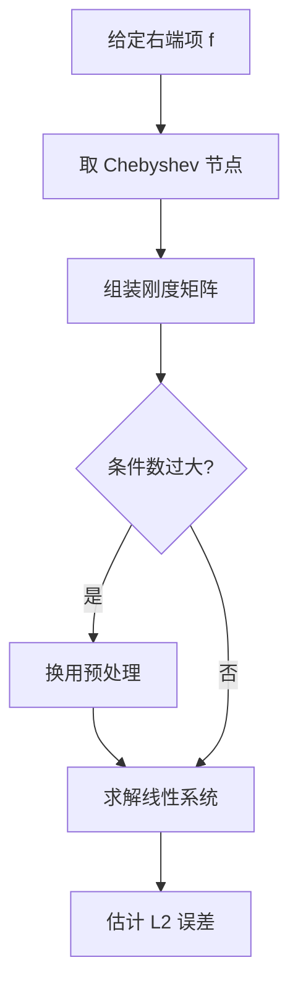
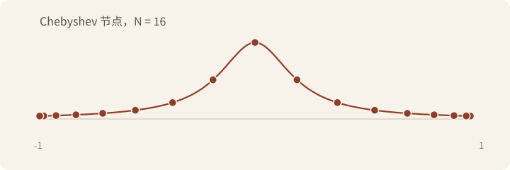

# 谱方法笔记：Poisson 方程

课程笔记，计算数学。方程、表格和后面的图都应该能安静地读完。

在有界区域 $\Omega\subset\mathbb{R}^d$ 上求解 Dirichlet 问题。未知量 $u$ 满足

$$
-\Delta u = f \quad \text{在 } \Omega \text{ 内}, \qquad u = 0 \quad \text{在 } \partial\Omega \text{ 上}.
$$

弱形式写成 \( a(u,v)=(f,v) \)。其中 $a(u,v)=\int_\Omega \nabla u\cdot\nabla v\,dx$，配置点取 Chebyshev 极值点 $x_j=\cos\frac{j\pi}{N}$，$j=0,\ldots,N$。化学式 $\ce{H2O <=> H+ + OH-}$ 用来确认 mhchem。

## 收敛

光滑解时期望看到指数衰减，而不是代数阶。下面这组数来自一次双精度试验。

| $N$ | $L^2$ 误差 | 观察到的阶 | 备注 |
|---:|---:|---:|---|
| 8 | $1.2\times 10^{-3}$ | — | 粗网格 |
| 16 | $4.7\times 10^{-6}$ | $8.0$ | |
| 32 | $1.1\times 10^{-12}$ | $12.1$ | 接近舍入误差 |

## 离散格式

试探空间取 $V_N=\mathrm{span}\{\phi_0,\ldots,\phi_N\}$。系数向量 $\hat u$ 来自

\begin{align}
a(u,v) &= \int_{\Omega}\nabla u\cdot\nabla v\,dx, \\
(f,v) &= \int_{\Omega} f v\,dx.
\end{align}

\begin{equation}
u_N = \sum_{k=0}^{N} \hat u_k \phi_k
\end{equation}

一维三点模板写成

\begin{equation}
\begin{pmatrix}
2 & -1 & 0 \\
-1 & 2 & -1 \\
0 & -1 & 2
\end{pmatrix}
\begin{pmatrix}
u_1 \\ u_2 \\ u_3
\end{pmatrix}
=
\begin{pmatrix}
f_1 \\ f_2 \\ f_3
\end{pmatrix}.
\end{equation}

分段右端项用

\[
f(x)=
\begin{cases}
x^2 & x\ge 0\\
-x & x< 0
\end{cases}
\]

> [!NOTE]
> 光滑函数的谱逼近以指数阶收敛。把网格加密一倍，往往比把差分格式升一阶更划算。

> [!abstract] 一句话总结
>
> 时间离散的 Stokes 流占半平面 $x < 0$，界面只做法向运动。这时流体 DtN 符号是
>
> $$
> \mathcal{N}(\xi) = |\xi|.
> $$
>
> - 半平面 $x<0$
> - 界面只做法向运动
>
> 记号写成 `DtN`。

> [!example] 怎么看误差曲线
>
> - 纵轴是误差 $e_N$
> - 横轴是自由度 $N$
>
> **先看斜率，再看是否进入平台。**

> [!info]- 补充：随体导数
>
> 速度 $u$ 的随体导数写成
>
> $$
> \frac{Du}{Dt}=\partial_t u+u\cdot\nabla u.
> $$
>
> | 项 | 含义 |
> | --- | --- |
> | $\partial_t u$ | 局部变化 |
> | $u\cdot\nabla u$ | 对流 |

~~有限差分是唯一可接受的选择~~ 谱方法在解析解上通常快得多。详见 https://katex.org 以及 [Trefethen 的谱方法讲义](https://people.maths.ox.ac.uk/trefethen/)。

## 实现清单

- [x] 组装刚度矩阵
- [x] 用 FFT 做 Chebyshev 求导
- [ ] 换成多重网格预处理
- [ ] 把收敛表写进论文附录

经典参考是 Trefethen 的书[^trefethen]。行内代码不应被当成公式：`$not math$`。

[^trefethen]: Lloyd N. Trefethen, *Spectral Methods in MATLAB*, SIAM, 2000.

## 求导矩阵

```python
import numpy as np

def cheb_diff(n: int) -> np.ndarray:
    """Chebyshev 极值点上的谱求导矩阵，区间 [-1, 1]。"""
    if n < 1:
        raise ValueError("n 至少为 1")
    x = np.cos(np.pi * np.arange(n + 1) / n)
    c = np.ones(n + 1)
    c[0] = c[-1] = 2.0
    c *= (-1) ** np.arange(n + 1)
    X = np.subtract.outer(x, x)
    D = np.outer(c, 1 / c) / (X + np.eye(n + 1))
    D -= np.diag(D.sum(axis=1))
    return D
```

```latex
% 这段应保持为代码，而不是公式
\begin{align}
a &= b
\end{align}
```

## 求解流程



## 算法

```latex
% 需要：\usepackage{algorithm} \usepackage{algpseudocode}
\begin{algorithm}[H]
\caption{Chebyshev 配点求解 Poisson 方程}
\begin{algorithmic}[1]
\Require 节点数 $N$，右端 $f$，边界值 $u(\pm1)=0$
\State 生成 Chebyshev 节点 $x_j=\cos(j\pi/N)$ \Comment{$j=0,\dots,N$}
\State 组装求导矩阵 $D$，令 $L\gets D^2$
\For{$j\in\{0,N\}$} \Comment{边界行}
    \State $L_{j,:}\gets\mathbf e_j^\top$，$f_j\gets0$
\EndFor
\State 解 $L\mathbf u=\mathbf f$
\Ensure 节点值 $\mathbf u$
\end{algorithmic}
\end{algorithm}
```

## 节点分布

Chebyshev 节点在端点聚集，这正是谱方法压低 Runge 现象的原因。



## 仍要核对的事

### 边界提升

升阶基函数在边界上自动满足齐次 Dirichlet 条件时，矩阵会少两行。

### 和有限元的对照

同样的 $H^1$ 半范数，有限元的误差是 $O(h^k)$，这里则跟踪 $e^{-cN}$。

## 窄窗口

窗口变窄时正文重排，字号保持不变。这条链接应该在栏内折行，而不是把整页撑宽：https://example.com/notes/spectral-methods/chebyshev-differentiation-matrix-and-the-very-long-path-segment-that-must-stay-inside-the-reading-column

$$
\hat u_k=\frac{2}{c_k N}\sum_{j=0}^{N}\frac{u(x_j)}{c_j}\cos\frac{kj\pi}{N},\quad
c_0=c_N=2,\quad
u_N(x)=\sum_{k=0}^{N}\hat u_k T_k(x),\quad
\|u-u_N\|_{H^1(\Omega)}\le C e^{-cN}.
$$

| 节点 | 权重 | 基函数 | 右端项 | 残差 | 预处理 | 迭代 | 备注 |
|---|---|---|---|---|---|---|---|
| \(x_0\) | \(w_0\) | \(T_0\) | \(f_0\) | \(1.0\times 10^{-3}\) | Jacobi | 12 | 端点 |
| \(x_1\) | \(w_1\) | \(T_1\) | \(f_1\) | \(4.7\times 10^{-6}\) | 无 | 8 | |
| \(x_2\) | \(w_2\) | \(T_2\) | \(f_2\) | \(1.1\times 10^{-12}\) | 无 | 4 | 接近舍入 |

```text
chebyshev-differentiation-matrix row 0:  0.000000  -2.000000  0.666667  -0.500000  0.400000  -0.333333  0.285714  -0.250000  0.222222  -0.200000
```
